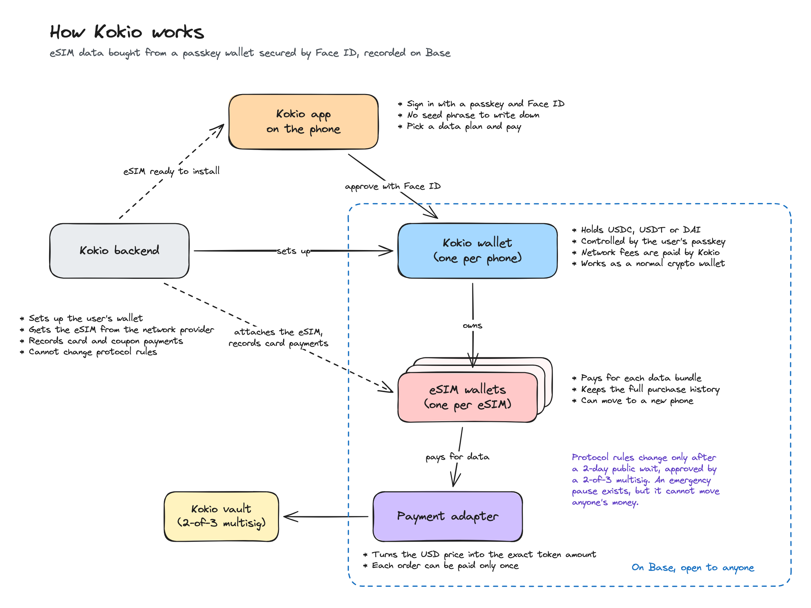
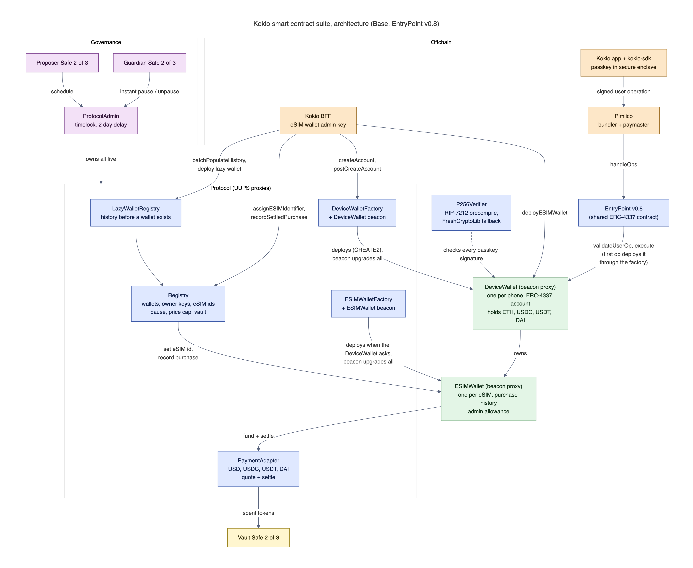
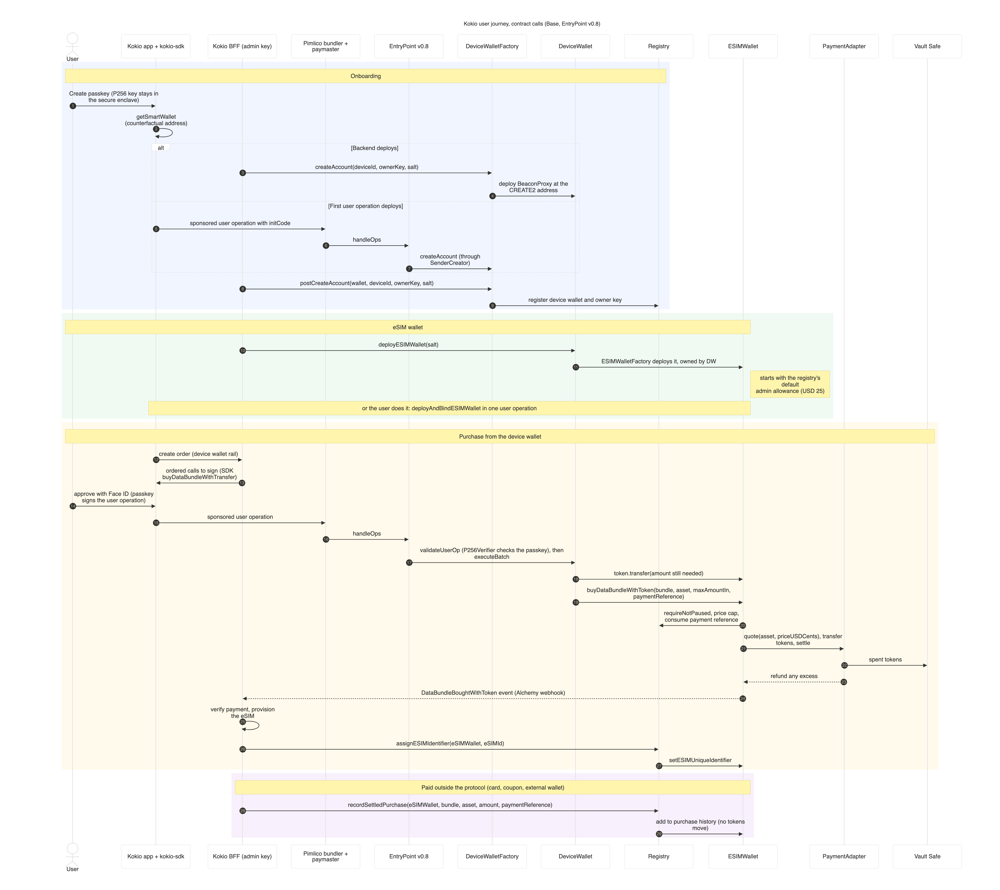

# eSIM Wallet Smart Contract Suite



Onchain wallets for eSIM data plans. A phone gets one smart wallet controlled by a passkey, and
every eSIM on that phone gets its own wallet that buys data bundles and keeps the record of what it bought.

The wallets are ERC-4337 accounts. Signatures are WebAuthn assertions over a P256 key held in the
device's secure enclave, so no seed phrase appears anywhere in the flow.

## Architecture



Two proxy layers, and most of the risk sits in them. Five UUPS singletons hold protocol state and
upgrade one at a time. Every wallet is a beacon proxy, so one beacon call moves every wallet of that kind at once. There is no per-wallet opt-out, which makes any beacon change a protocol-wide upgrade.

| Contract | What it does | Pattern |
|---|---|---|
| `Registry` | Central record of every device and eSIM wallet. Also holds the protocol admin, the vault, the pause switch, the data bundle price ceiling and the default admin allowance | UUPS proxy |
| `RegistryHelper` | The registry's storage and lazy deployment half | Inherited by `Registry` |
| `LazyWalletRegistry` | Holds data bundle history for users paying in fiat, keyed by device and eSIM identifier strings, until they ask for a wallet | UUPS proxy |
| `DeviceWalletFactory` | Deploys device wallets at deterministic CREATE2 addresses and owns their beacon | UUPS proxy |
| `DeviceWallet` | One per phone. Holds ETH and tokens, owns the eSIM wallets on that device, verifies the passkey | Beacon proxy |
| `ESIMWalletFactory` | Deploys eSIM wallets and owns their beacon | UUPS proxy |
| `ESIMWallet` | One per eSIM. Buys data bundles, keeps purchase history, pulls tokens from its device wallet, and limits what the admin key may charge it (the admin allowance) | Beacon proxy |
| `PaymentAdapter` | The currencies the protocol accepts, the one conversion from USD cents into a token amount, and the payment references each spendable once. Moves tokens to the vault | UUPS proxy |
| `Account4337` | The ERC-4337 `IAccount` and `IERC1271` base that `DeviceWallet` builds on | Inherited by `DeviceWallet` |
| `WebAuthn` | Verifies WebAuthn authentication assertions. Tries the RIP-7212 precompile first and falls back to FreshCryptoLib | Library |
| `P256Verifier` | One immutable address for accounts to verify through, wrapping the WebAuthn library | Plain contract |
| `ProtocolAdmin` | Timelock that owns the five singletons. Adds a delay floor that `updateDelay` cannot go under, and a guardian role with four instant powers: pause, unpause, suspend the admin key, and strip a canceller | Plain contract |
| `Errors` | Every custom error in the suite | Library |
| `CustomStructs` | Structs shared across contracts | Types |
| `interfaces/` | `IPausable`, `IOwnable2Step` and `IRegistryAdmin` for the calls `ProtocolAdmin` makes back into the protocol; `IPaymentRegistry` for what `PaymentAdapter` reads from the registry | Interfaces |

A backend server generates the device and eSIM identifiers and writes them into the wallets. That is what ties an onchain wallet to a provisioned eSIM.

## Deployments

Both use EntryPoint v0.8. Base mainnet is deployed from commit [`a14470c`](https://github.com/Blockchain-Powered-eSIM/smart-contract-suite/tree/a14470cc9c98c6d6dcaa5cec33f779e765b07808), Base Sepolia from [`e1b7de8`](https://github.com/Blockchain-Powered-eSIM/smart-contract-suite/tree/e1b7de8cd16d43bcd9a10bdd13b392e5841e98fc).

| Contract | Base mainnet | Base Sepolia |
|---|---|---|
| `RegistryProxy` | [`0x76fB7F8C97457A5a6dF19a7041a66a7f1b3c910c`](https://basescan.org/address/0x76fB7F8C97457A5a6dF19a7041a66a7f1b3c910c) | [`0x916b6b554119c789EF3026EDeB0E1Ba741b42A49`](https://sepolia.basescan.org/address/0x916b6b554119c789EF3026EDeB0E1Ba741b42A49) |
| `LazyWalletRegistryProxy` | [`0x2046aE906FB940Ad99147f233711Bb6711A2Ab0C`](https://basescan.org/address/0x2046aE906FB940Ad99147f233711Bb6711A2Ab0C) | [`0x5bE46Cf216186Bc2E3C220729331D6bE7d186e84`](https://sepolia.basescan.org/address/0x5bE46Cf216186Bc2E3C220729331D6bE7d186e84) |
| `DeviceWalletFactoryProxy` | [`0xAC6B6A9F905e2593d587D244cEee6a0886952a6D`](https://basescan.org/address/0xAC6B6A9F905e2593d587D244cEee6a0886952a6D) | [`0x0BB3BA8D9233514a4aA6D72c243a2473f9cFf0bb`](https://sepolia.basescan.org/address/0x0BB3BA8D9233514a4aA6D72c243a2473f9cFf0bb) |
| `ESIMWalletFactoryProxy` | [`0xC88723826B9070ea89d9040387DE4C22A490EdB6`](https://basescan.org/address/0xC88723826B9070ea89d9040387DE4C22A490EdB6) | [`0x57da54e07705de17c713ec311ac193e83470D5a5`](https://sepolia.basescan.org/address/0x57da54e07705de17c713ec311ac193e83470D5a5) |
| `PaymentAdapterProxy` | [`0xbb80B10BECB997b02a4BA4068C145Ef18129943d`](https://basescan.org/address/0xbb80B10BECB997b02a4BA4068C145Ef18129943d) | [`0xBFaA666a8074924588E96507c307b680ecCeB2c1`](https://sepolia.basescan.org/address/0xBFaA666a8074924588E96507c307b680ecCeB2c1) |
| `DeviceWalletImpl` | [`0xA32738E9Bdd5ddea70cb487AAf445aba04f00322`](https://basescan.org/address/0xA32738E9Bdd5ddea70cb487AAf445aba04f00322) | [`0x2dc7d2997C5ddd1BD4446C4BEFacf706BDDeACcD`](https://sepolia.basescan.org/address/0x2dc7d2997C5ddd1BD4446C4BEFacf706BDDeACcD) |
| `ESIMWalletImpl` | [`0xE6226A0D758E58518a1b279B00d5483e4B0D97Db`](https://basescan.org/address/0xE6226A0D758E58518a1b279B00d5483e4B0D97Db) | [`0x6B849c989D1Fd11e7BeCF76668dc2B09A075474C`](https://sepolia.basescan.org/address/0x6B849c989D1Fd11e7BeCF76668dc2B09A075474C) |
| `DeviceWalletBeacon` | [`0x3c3B431C0e3289DDEAc1F20Eb49e11bE5a0daFcA`](https://basescan.org/address/0x3c3B431C0e3289DDEAc1F20Eb49e11bE5a0daFcA) | [`0x81Ac8133Ab32151460898D402E2f0dd0c6FfA30f`](https://sepolia.basescan.org/address/0x81Ac8133Ab32151460898D402E2f0dd0c6FfA30f) |
| `ESIMWalletBeacon` | [`0x7C5F070927032BEfEda6f375da2ad97C3eaf2bd9`](https://basescan.org/address/0x7C5F070927032BEfEda6f375da2ad97C3eaf2bd9) | [`0xc2C09990cA54c3B0A88C9F51d540f9cf78F4D424`](https://sepolia.basescan.org/address/0xc2C09990cA54c3B0A88C9F51d540f9cf78F4D424) |
| `P256Verifier` | [`0x4E2C5B9B88184464162d581D6BF36615f0040fE6`](https://basescan.org/address/0x4E2C5B9B88184464162d581D6BF36615f0040fE6) | [`0x6FA3E7E145476Dc4682734Fd845019A3872b4821`](https://sepolia.basescan.org/address/0x6FA3E7E145476Dc4682734Fd845019A3872b4821) |
| `ProtocolAdmin` | [`0x0E664e956aAD2599D17dE2381cc22687a066778B`](https://basescan.org/address/0x0E664e956aAD2599D17dE2381cc22687a066778B) | [`0xdBC411D2fEc7758B32885DbF0B4AE957c3b918Fe`](https://sepolia.basescan.org/address/0xdBC411D2fEc7758B32885DbF0B4AE957c3b918Fe) |
| `EntryPoint` | [`0x4337084D9E255Ff0702461CF8895CE9E3b5Ff108`](https://basescan.org/address/0x4337084D9E255Ff0702461CF8895CE9E3b5Ff108) | [`0x4337084D9E255Ff0702461CF8895CE9E3b5Ff108`](https://sepolia.basescan.org/address/0x4337084D9E255Ff0702461CF8895CE9E3b5Ff108) |

[deployments/address.json](./deployments/address.json) lists addresses only. Build provenance, every transaction, gas, constructor arguments and verification status are in [deployments/base-8453-entrypoint-v8.json](./deployments/base-8453-entrypoint-v8.json) and [deployments/base-sepolia-84532-entrypoint-v8.json](./deployments/base-sepolia-84532-entrypoint-v8.json). The Base Sepolia file also records the upgrade operation and its payloads.

## User flow



1. **Install the app and register a passkey.** The P256 key lives in the device's secure enclave and never leaves it. The SDK works out the device wallet's address before anything is deployed.
2. **Deploy the device wallet.** The backend calls `DeviceWalletFactory.createAccount`, or the user's first sponsored user operation does it through the EntryPoint. The backend then registers the wallet and its owner key with `postCreateAccount`.
3. **Deploy an eSIM wallet.** The backend calls `deployESIMWallet` on the device wallet, or the user does it in one user operation with `deployAndBindESIMWallet`. A new eSIM wallet starts with the registry's default admin allowance.
4. **Buy a data bundle.** Three ways, all ending in the eSIM wallet's purchase history:
   - From the device wallet: the user signs one user operation that tops up the eSIM wallet and calls `buyDataBundleWithToken`. The payment adapter prices the bundle in USDC, USDT or DAI and sends the exact amount to the vault.
   - Paid outside the protocol (card, coupon, external wallet): the backend records the purchase with `recordSettledPurchase`. No tokens move.
   - Paid before the user has a wallet: the backend keeps the history in the lazy wallet registry, then deploys the wallets and copies the history in when the user installs the app.

   Paying in ETH is not currently supported. The adapter works the amount out from the price, and nothing onchain prices ETH, so it comes back when the adapter can swap into the settlement token.
5. **Provision the eSIM.** The backend gets the eSIM from the provider and writes its identifier into the eSIM wallet with `Registry.assignESIMIdentifier`.
6. **Use the device wallet.** It holds ETH and ERC-20 tokens and can be used as an ordinary wallet. Funds can be withdrawn at any time.

## Quickstart

Foundry 1.7.1, solc 0.8.36, `evm_version = "osaka"`.

```bash
git clone --recurse-submodules https://github.com/Blockchain-Powered-eSIM/smart-contract-suite.git
cd smart-contract-suite
forge build --sizes
forge test
```

This repo does not compile without via-IR. `via_ir = true` is already in `foundry.toml`, so plain
`forge` commands pick it up. A cold build takes about 30 seconds.

Dependencies are git submodules under `lib/`.
Hardhat is wired up through `@nomicfoundation/hardhat-foundry` and compiles the same sources, so `npx hardhat compile` produces byte-identical bytecode.
That parity depends on `bytecode_hash = "none"` in `foundry.toml` and `metadata.bytecodeHash: "none"` in `hardhat.config.js`. Removing either breaks it.

## Testing

819 tests across 73 suites, about eight minutes for a full run.

| Suite | Files | What it covers |
|---|---|---|
| `test/foundry/unit-testing/` | 44 | Per-contract behaviour, access control, revert paths, storage layout and initialiser locks |
| `test/foundry/fuzz-testing/` | 10 | Identifier and array shapes, price ceilings, token settlement, signature shapes, a P256 differential against the precompile |
| `test/foundry/invariant-testing/` | 9 | Registry consistency, wallet ownership, payment accounting, purchase history, timelock behaviour |
| `test/foundry/gas/` | 8 | Per-operation gas with every input pinned, offchain signatures included |
| `test/foundry/fork/` | 1 | A user operation through the deployed EntryPoint on both chains |

Branch coverage is 92.58%, or 237 of 256 arms, with `WebAuthn` at 80% the lowest and
`Account4337`, `ProtocolAdmin`, `DeviceWallet` and `PaymentAdapter` at 100%.
Measure it with `scripts/checks/branch-coverage.py` rather than reading forge's own percentage:
`forge coverage --ir-minimum` does not count `require(cond, "string")` as a branch, so those sites
report zero hits on both arms however often they run. The contracts use custom errors throughout, so nothing is currently excluded, but the raw number stops meaning anything the moment a `require`
string is added.

```bash
forge coverage --ir-minimum --report lcov --report-file lcov.info \
    --no-match-path "test/foundry/{fork,invariant-testing}/*"
python3 scripts/checks/branch-coverage.py lcov.info
```

The fork tests read `ALCHEMY_OP_SEPOLIA_HTTPS` and `ALCHEMY_BASE_SEPOLIA_HTTPS`. They skip rather
than fail when those are unset, so the suite runs without credentials.

The long invariant campaign is a separate profile, run before a release rather than on every change:

```bash
FOUNDRY_PROFILE=campaign forge test --match-path "test/foundry/invariant-testing/*"
```

The deployment scripts have their own suite, kept out of the default run:

```bash
FOUNDRY_PROFILE=scripts forge test --threads 1
```

50 tests in `test/scripts/`, exercising `Deploy.s.sol`, `Configure.s.sol` and `TransferOwnership.s.sol`
against a scratch record. `scripts/fork/rehearse.sh` runs the same three against a Base Sepolia fork
and checks the happy path better than any test can, but it needs an RPC key and a live anvil, so CI
never runs it. These reach what it cannot: the resume branches and the mismatch guards, which only
fire on a deployment that has already gone wrong.

`--threads 1` is not optional. The scripts read their parameters from the process environment and
their record from one file, and forge runs every `setUp` before any test and then runs the tests in
parallel. Without the flag, somewhere between 2 and 12 of the 50 fail on each run, and which ones
changes every time.

Two gas baselines, measuring different things. `.gas-snapshot` is the whole-test-body figure, useful as a regression tripwire and not as a protocol gas number, since a row can include whatever that test deployed.
`snapshots/*.json` is per operation, written by the tests under `test/foundry/gas/` and rewritten by any ordinary `forge test`.

## Security

**Audit.** Reviewed by CD Security in March 2025. The report is in [audits/2025-03-CDSecurity.pdf](./audits/2025-03-CDSecurity.pdf).

**Formal verification.** Eight Certora specs, 83 rules.

| Spec | Rules | Subject |
|---|---|---|
| `Registry.spec` | 18 | Wallet registration and association records |
| `PaymentAdapter.spec` | 15 | The currency table, the payment references, and what a settlement moves |
| `ProtocolAdmin.spec` | 11 | The delay nothing gets around, and the two things a guardian can say |
| `ESIMWallet.spec` | 10 | Ownership state machine, price ceiling, deploying factory |
| `ESIMWalletFactory.spec` | 10 | Registry wiring, beacon control, the record of what it deployed |
| `DeviceWalletFactory.spec` | 8 | Deterministic deployment and beacon control |
| `DeviceWallet.spec` | 7 | Owner key, eSIM wallet set, funds access flags |
| `RegistryCrossContract.spec` | 4 | `Registry`, `DeviceWallet` and `ESIMWallet` agreeing on who holds an eSIM wallet |

Three caveats attach to every proof. Loops unroll three times, so a result covers batches of at most three rather than all batches. Hashing of unbounded arguments is assumed within 224 bytes, raised to 1600 in `ESIMWalletFactory.spec` so its CREATE2 address prediction stays reachable. External calls are summarised one signature at a time.

`LazyWalletRegistry` has no spec, and the reason is every mapping in it is string-keyed, and Certora's storage analysis fails on any method taking a `string`.
Its properties are carried by Foundry invariants instead.

**Static analysis.** Slither and Aderyn run before anything substantial is committed:

```bash
slither . --filter-paths "test/,script/,lib/,node_modules/"
aderyn .
```

**Trust model, as it stands.** On both Base mainnet and Base Sepolia, `ProtocolAdmin` owns all five UUPS proxies, `PaymentAdapter` included, and both factories that own the beacons. Every owner gated call waits out a two day delay. On Base Sepolia, proposing is 2-of-3 or a cold key, and a 3-of-3 guardian executes. Admin transactions go into the public mempool, with no private relay in front of them.

## Specifications

- [Registry](./docs/Registry.md)
- [Registry Helper](./docs/RegistryHelper.md)
- [Lazy Wallet Registry](./docs/LazyWalletRegistry.md)
- [Protocol Admin](./docs/admin/ProtocolAdmin.md)
- [Device Wallet Factory](./docs/device-wallet/DeviceWalletFactory.md)
- [Device Wallet](./docs/device-wallet/DeviceWallet.md)
- [eSIM Wallet Factory](./docs/esim-wallet/ESIMWalletFactory.md)
- [eSIM Wallet](./docs/esim-wallet/ESIMWallet.md)
- [Payment Adapter](./docs/payments/PaymentAdapter.md)
- [Account4337](./docs/aa-helper/Account4337.md)
- [Upgradeable Beacon](./docs/UpgradableBeacon.md)
- [Custom Structs](./docs/CustomStructs.md)
- [Errors](./docs/Errors.md)
- [Ownable Two-Step Interface](./docs/interfaces/IOwnable2Step.md)
- [Pausable Interface](./docs/interfaces/IPausable.md)
- [Registry Admin Interface](./docs/interfaces/IRegistryAdmin.md)
- [Payment Registry Interface](./docs/interfaces/IPaymentRegistry.md)
- [P256 Verifier](./docs/P256Verifier.md)
- [WebAuthn](./docs/WebAuthn.md)
